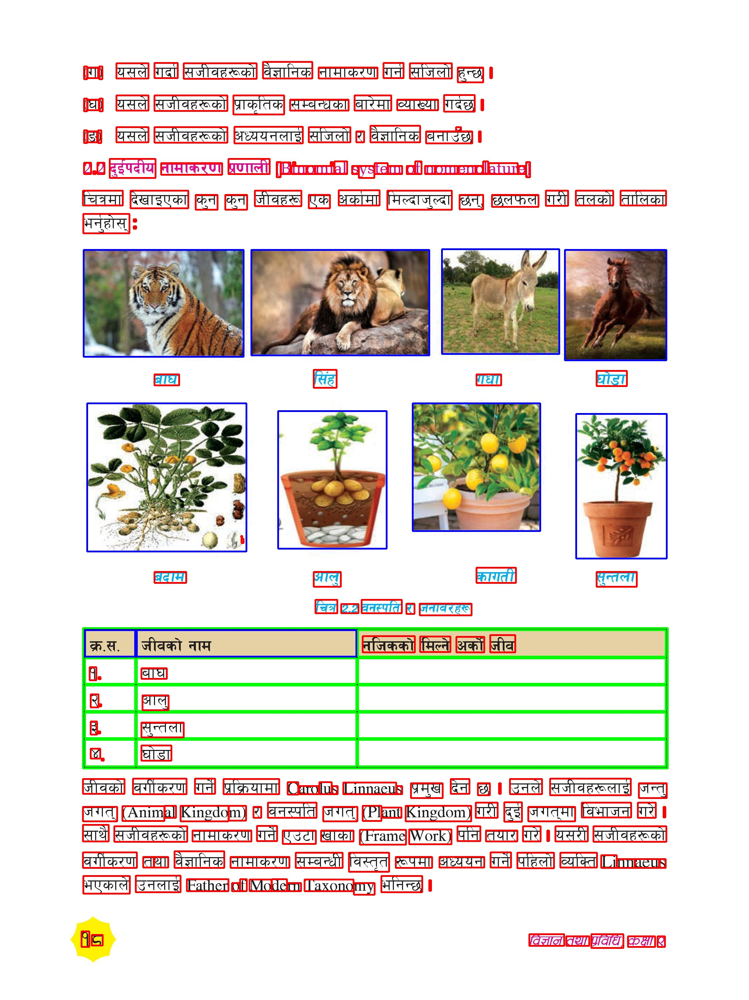

# NepaliOCR

Document layout segmentation and bilingual Devanagari/English OCR pipeline for Nepali textbooks.



## Architecture

### 1. Spatial-Grid Layout Detection (`detector.py` & `customDataStruct/`)
- **Iterative Contour Bridging (`contourCorrection`)**: Thresholds grayscale pages (`DETECTREGION = 190`) and draws contours over `iteration` passes so characters sharing a Devanagari *shirorekha* (top bar) and their upper/lower vowel matras fuse into single word-level contours.
- **Region Classification (`mergeAndClassify`)**: Computes the L1 relative difference between bounding-box area and contour area (`AREAFACTOR = 0.1`) along with quantized HSV color spread (`colorSpread`, `colorCount`) to classify each contour as `'text'` (red), `'Image'` (blue), or `'Table'` (green).
- **2D Spatial Hash Grid (`RectSet`, `Rect`, `DynamicNpy`)**: Partitions the page into `200 x 200` pixel blocks so newly added `'text'` or `'Image'` boxes only check overlap against rectangles in shared grid cells. Overlapping boxes merge transitively into their bounding union while `'Table'` borders remain unmerged.

### 2. Vertical-Band CRNN + CTC Recognizer (`learn.py` & `recognizer.py`)
- **Aspect-Preserving Preprocessing (`preProcess`)**: Scales word or line crops to height `32` (`cv2.INTER_CUBIC` / `cv2.INTER_AREA`), stretches foreground ink intensity between the 10th and 99th percentiles to preserve thin anti-aliased matras, and expands width dynamically to a multiple of `4` when crops exceed `192` px.
- **Backbone (`_DevanagariCRNNNet`)**: Standard Latin CRNNs pool vertical height down to `H = 1`, which collapses stacked Devanagari modifiers into the base consonant. `_DevanagariCRNNNet` (`3.66M` parameters) pools `(32, W, 1)` to `(C=128, H=4, T=W//4)` using asymmetric `(2, 1)` pooling in Stage 3, keeping 4 vertical bands (upper matras, upper/lower consonant body, and subscript matras) before projecting `128 * 4 -> 256` into a 2-layer bidirectional LSTM (`hidden_size = 256`) and `141`-class CTC output head (`140` characters + blank).

### 3. Preeti-to-Unicode Converter (`utility.py`)
- **`preeti2Uni`**: Converts legacy Preeti-encoded `.docx`/PDF text streams into Unicode Devanagari, handling multi-keystroke ligatures (`j|m -> क्र`, `km -> फ`), half-forms + `f` (`Kf -> प`), pre-base `'l'` (`ि`) reordering after consonant clusters, and post-typed `'{'` (*reph* `र्`) insertion before the preceding cluster.

## Evaluation

Trained on `19,055` word crops extracted from Pages `11–100` of the CDC Nepal Grade 9 Science & Technology textbook (`crnn_nepali_ocr.pt`) and evaluated on unseen chapters and a separate Grade 10 Social Studies textbook:

| Split | Source | Words | Exact Word Accuracy | Character Accuracy (`1 - CER`) |
| :--- | :--- | :---: | :---: | :---: |
| Train | Grade 9 Science (`Pages 11–100`) | `2,000` | `100.0%` | `100.0%` |
| Unseen Chapters | Grade 9 Science (`Pages 200–214`) | `3,672` | `89.0%` | `95.4%` |
| Unseen Textbook | Grade 10 Social Studies (`Pages 15–29`) | `3,101` | `89.6%` | `96.8%` |

## Usage

### Run Layout Detection & OCR on a Page Image

```python
import cv2
from pdfOCR import processImagePage

img = cv2.imread("gr9sctrain23_detected.jpg")
result = processImagePage(img)

for item in result["text"][:10]:
    print(item["rect"], "->", item["text"])
```

### Convert a PDF or Image from the CLI

```bash
python3 pdfOCR.py page.jpg
```

### Run Unit Tests

```bash
python3 test_ocr.py -v
```

## License

MIT License
