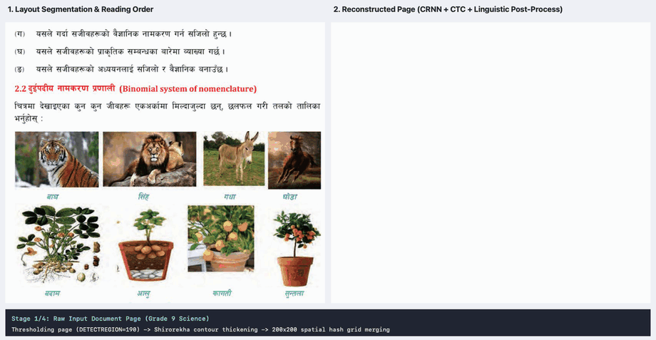

# NepaliOCR

Document layout segmentation and bilingual Devanagari/English OCR pipeline for Nepali textbooks.



## Project Structure

```text
NepaliOCR/
├── nepali_ocr/
│   ├── spatial/          # Point, Rect, DynamicArray, and 2D spatial-grid RectSet
│   ├── detector.py       # Iterative contour bridging, HSV region classifier, projection profiles
│   ├── model.py          # PyTorch 4-band vertical residual CRNN + BiLSTM + CTC loss
│   ├── recognizer.py     # Aspect-preserving crop preprocessing and greedy CTC decoding
│   ├── postprocess.py    # Devanagari linguistic normalization and visual-to-logical ordering
│   ├── utils.py          # Preeti-to-Unicode converter, color heuristics, 140-char vocabulary
│   ├── io_pdf.py         # PDFReader rasterization and PDFWriter layout reconstruction
│   └── pipeline.py       # End-to-end page image and PDF OCR pipeline
├── tools/
│   ├── dataset_annotator.py
│   └── docx_parser.py
├── tests/
│   └── test_ocr.py
├── docs/
│   └── index.md
├── assets/
│   └── gr9sctrain23_detected.jpg
└── display.gif
```

## Architecture

### 1. Spatial-Grid Layout Detection (`nepali_ocr/detector.py` & `nepali_ocr/spatial/`)
- **Iterative Contour Bridging (`contour_correction`)**: Thresholds grayscale pages (`DETECTREGION = 190`) and draws contours over `iteration` passes so characters sharing a Devanagari *shirorekha* (top bar) and their upper/lower vowel matras fuse into single word-level contours.
- **Region Classification (`merge_and_classify`)**: Computes the L1 relative difference between bounding-box area and contour area (`AREAFACTOR = 0.1`) along with quantized HSV color spread (`color_spread`, `color_count`) to classify each contour as `'text'` (red), `'Image'` (blue), or `'Table'` (green).
- **2D Spatial Hash Grid (`RectSet`, `Rect`, `DynamicArray`)**: Partitions the page into `200 x 200` pixel blocks so newly added `'text'` or `'Image'` boxes only check overlap against rectangles in shared grid cells. Overlapping boxes merge transitively into their bounding union while `'Table'` borders remain unmerged.

### 2. Vertical-Band CRNN + CTC Recognizer (`nepali_ocr/model.py` & `nepali_ocr/recognizer.py`)
- **Aspect-Preserving Preprocessing (`preprocess_crop`)**: Scales word or line crops to height `32` (`cv2.INTER_CUBIC` / `cv2.INTER_AREA`), stretches foreground ink intensity between the 10th and 99th percentiles to preserve thin anti-aliased matras, and expands width dynamically to a multiple of `4` when crops exceed `192` px.
- **Backbone (`_DevanagariCRNNNet`)**: Standard Latin CRNNs pool vertical height down to `H = 1`, which collapses stacked Devanagari modifiers into the base consonant. `_DevanagariCRNNNet` (`3.66M` parameters) pools `(32, W, 1)` to `(C=128, H=4, T=W//4)` using asymmetric `(2, 1)` pooling in Stage 3, keeping 4 vertical bands (upper matras, upper/lower consonant body, and subscript matras) before projecting `128 * 4 -> 256` into a 2-layer bidirectional LSTM (`hidden_size = 256`) and `141`-class CTC output head (`140` characters + blank).

### 3. Preeti-to-Unicode Converter (`nepali_ocr/utils.py`)
- **`preeti_to_unicode`**: Converts legacy Preeti-encoded `.docx`/PDF text streams into Unicode Devanagari, handling multi-keystroke ligatures (`j|m -> क्र`, `km -> फ`), half-forms + `f` (`Kf -> प`), pre-base `'l'` (`ि`) reordering after consonant clusters, and post-typed `'{'` (*reph* `र्`) insertion before the preceding cluster.

## Data Sources & Training Data Preparation

Publicly available Nepali textbook PDFs and character datasets that can be used with `tools/dataset_annotator.py` and `CRNN.train`:

- **Curriculum Development Centre (CDC), Ministry of Education, Nepal** ([moecdc.gov.np](https://moecdc.gov.np)): Official Nepali-medium school textbooks (Grades 1–12 Science, Social Studies, Nepali) in digital PDF format.
- **E-Pustakalaya Digital Library (OLE Nepal)** ([pustakalaya.org](https://pustakalaya.org)): Open-access digital repository hosting CDC curriculum textbooks and Nepali literature PDFs.
- **UCI Devanagari Handwritten Character Dataset (DHCD)** ([archive.ics.uci.edu/ml/datasets/Devanagari+Handwritten+Character+Dataset](https://archive.ics.uci.edu/ml/datasets/Devanagari+Handwritten+Character+Dataset)): `92,000` character images across `46` Devanagari consonant and digit classes for pretraining or augmentation.

## Evaluation (Toy Training Benchmark)

> **Note:** The results below come from a **toy training setup** trained on `19,055` clean digital word crops extracted from Pages `11–100` of a single CDC Grade 9 Science & Technology textbook PDF. Because the training set is limited to clean, single-font PDF renders, minor character confusions still occur on unseen words (e.g., matra ordering on `"सिंह"`), and performance will degrade on noisy scans or camera images. **For higher accuracy and real-world production usage, train `CRNN` on a larger, multi-font dataset of real scanned documents.**

| Split | Source | Words | Exact Word Accuracy | Character Accuracy (`1 - CER`) |
| :--- | :--- | :---: | :---: | :---: |
| Toy Train | Grade 9 Science (`Pages 11–100`) | `2,000` | `100.0%` | `100.0%` |
| Unseen Chapters | Grade 9 Science (`Pages 200–214`) | `3,672` | `89.0%` | `95.4%` |
| Unseen Textbook | Grade 10 Social Studies (`Pages 15–29`) | `3,101` | `89.6%` | `96.8%` |

## Usage

### Run Layout Detection & OCR on a Page Image

```python
import cv2
from nepali_ocr import process_image_page

img = cv2.imread("assets/gr9sctrain23_detected.jpg")
result = process_image_page(img)

for item in result["text"][:10]:
    print(item["rect"], "->", item["text"])
```

### Convert a PDF or Image from the CLI

```bash
python3 -m nepali_ocr.pipeline assets/gr9sctrain23_detected.jpg
```

### Run Unit Tests

```bash
python3 -m unittest discover -s tests -v
```

## License

MIT License
